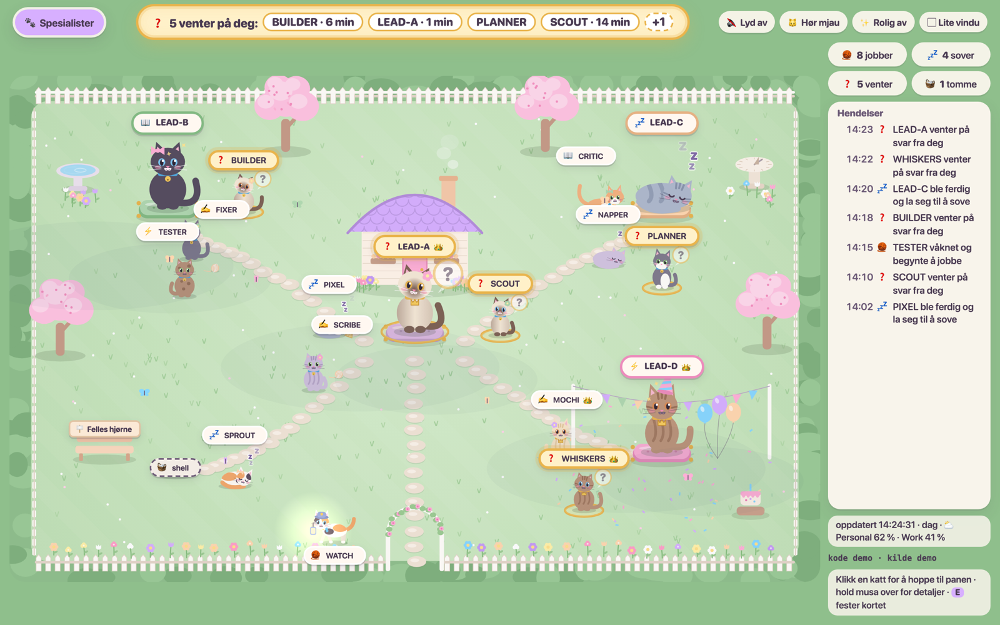
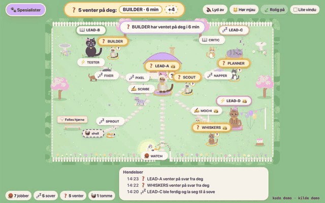
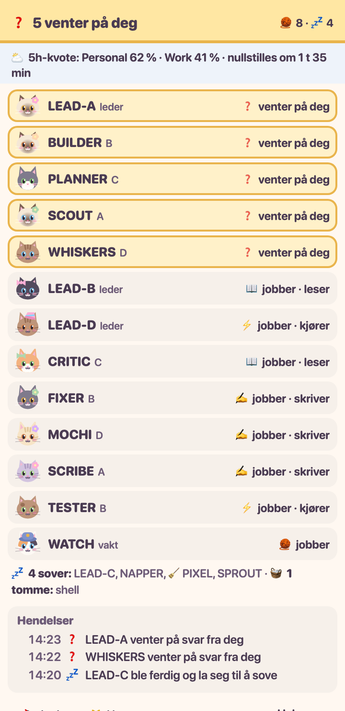

# Katte-hagen 🐈

> **Kort på norsk:** En levende hage der hver Claude Code-økt i tmux er en katt. Kattene
> jobber, sover og venter på deg, og siden viser hvem som trenger svar. Alt skjer lokalt på
> maskinen din. Grensesnittet er på norsk; resten av denne README-en er på engelsk.

**A living garden where every Claude Code session in tmux is a cat.**

Running several Claude Code sessions side by side in tmux? Katte-hagen ("the cat garden")
turns them into a small, calm garden you can keep open all day. Cats that are working run
around and play, cats that are done curl up and sleep, and the one that is waiting for your
answer sits in a golden ring at the top of the page. Click a cat to jump straight to its pane.







*All screenshots use made-up demo data.* The interface is in Norwegian (Bokmål).

## Requirements

- **macOS** with **tmux** (3.x) and **Node.js 20 or newer**. No npm packages — only Node's
  built-in modules.
- **Claude Code**, running inside tmux panes.
- A browser. Tested in Chrome/Chromium; other modern browsers should work but are untested.
  The "mini window" app uses Chrome's `--app` mode.
- Optional: [Ghostty](https://ghostty.org) for click-to-jump (configurable).

**Linux** probably works for the data source and the page, but not the launchd service, the
`.command` launcher, the macOS apps or click-to-jump (it uses macOS `open`). This has not been
tested.

## Setup in 5 minutes

```sh
git clone https://github.com/Mariisno/katte-hagen.git
cd katte-hagen
cp hage.config.example.json hage.config.json   # then edit the names, see Configuration
```

**Try it first without tmux:** open `spesialister.html?demo=1` in your browser. That shows
the garden with built-in demo data.

```sh
open "spesialister.html?demo=1"
```

**Run it for real** — pick one:

1. **In a terminal** (stops when you close it):

   ```sh
   node spesialister.mjs --live
   open spesialister.html
   ```

   On macOS you can also double-click `kattehage-live.command`, which does the same.

2. **As a background service** (macOS, starts at login and keeps running):

   ```sh
   scripts/install.sh                 # label: com.example.kattehage
   open spesialister.html
   ```

   Use your own label with `KATTEHAGE_LABEL=com.you.kattehage scripts/install.sh`.
   `scripts/install.sh --dry-run` prints the generated plist without changing anything.
   Check: `launchctl print gui/$(id -u)/com.example.kattehage | grep state`.
   Log: `tail -f ~/Library/Logs/kattehage.log`. Remove: `scripts/uninstall.sh`.

**Optional Dock apps:** `scripts/make-apps.sh` builds `apps/Katte-hagen.app` (the full garden)
and `apps/Mini-garden.app` (the compact list in a small window) with `osacompile`. They contain
the absolute path to your clone, so build them on your own machine.

### Naming your panes

The garden reads a tmux pane option to know who is who. Set it on each pane:

```sh
tmux set -p @name "LEAD-A · planning"                 # a lead
tmux set -p @name "SCOUT · research (LEAD-A)"          # a specialist that belongs to LEAD-A
tmux set -p @name "WATCH · night shift"                # the watch cat
```

- The **short name** is the text before ` · `. It is shown on the cat's label.
- A pane whose short name matches a lead in your config **is** that lead.
- A pane with `(LEAD-A` in its name belongs to LEAD-A and sits around it in the garden.
  Panes in a tmux session listed as a lead's `session` belong to that lead too.
- Everything else gathers in the **shared corner** for unknown cats, bottom left.
- Panes without a name still show up when they run Claude Code or a shell. They use the
  window name.

## Configuration

`hage.config.json` (gitignored). Every field is optional; missing fields fall back to the
example values.

| Field | What it does |
|---|---|
| `leaders` | Up to four leads. `name` is matched against pane names, `short` is the label in the compact list, `spot` is where the lead lives: `house` (centre), `birdbath` (top left), `sundial` (top right) or `party` (bottom right, with a party hat). `session` is an optional tmux session name whose panes belong to this lead. |
| `watchCat` | Short name of a "watch cat" that walks the fence with a lantern instead of sitting down. |
| `nameOption` | The tmux pane option holding the name. Default `@name`. |
| `accounts` | Labels for the account a session runs on, e.g. `Work` and `Personal`. `match` is a regular expression tested against the status line at the bottom of the pane; `collar` is `bell` or `crown`. Without a match the cat wears a grey collar and the card says "ukjent" (unknown). |
| `quota` | `{ "enabled": true }` turns on the weather: sun below 50 %, clouds 50–80 %, rain above 80 % of a 5-hour usage quota. Off by default, because it needs a custom status line that prints `5h ●●●○○○○○○○ 43%`. Set `pattern` to your own regular expression, with the percentage as group 1. |
| `intervalSeconds` | How often the data source reads tmux. Default 10. The page polls every 10 seconds; add `?poll=5000` to the address to change that. |
| `hopPort` | Port for the local click-to-jump helper (127.0.0.1 only). Default 8853. |
| `terminal` | App that opens when you click a cat. Default `Ghostty`. It gets `-e tmux …` as arguments. |
| `browser` | Browser used by `scripts/make-apps.sh`. Default `Google Chrome`. |

**In the page:**

- **🔇 Lyd / sound** is **off by default**. **🐱 Hør mjau** plays one meow so you can hear it.
  When sound is on, a cat says "mjau" when it finishes and "mjau?" when it starts waiting — only for panes you are not looking at, only from one tab,
  and with a reminder after 5 minutes (then every 15) while someone is still waiting.
- **🍃 Rolig / calm mode** turns off extra effects and caps the garden at 30 frames per
  second. It switches on automatically on non-Retina screens or when frames lag behind.
  `?rolig=1` or `?rolig=0` overrides it.
- **▢ Lite vindu / mini window** opens the compact list. Below 640 px width the page switches
  to that list by itself, so it can stay open in a corner all day.
- `?tid=21` shows the evening garden in the middle of the day.

## What the cats mean

| | Status | Means |
|---|---|---|
| 🧶 | **jobber** (working) | Claude is working. The icon above the cat says what: 📖 reading · ✍️ writing · ⚡ running. |
| 💤 | **sover** (done) | Claude finished and is back at the prompt. |
| ❓ | **venter** (waiting) | An open menu or question is waiting for **you**. These cats get a golden ring, a count in the tab title — "(2) Spesialist-hagen" — and the top of the page. |
| 🧺 | **tomt** (empty) | The pane runs a plain shell, no Claude. |
| 🧹 | **ready to tidy** | The cat has slept for more than 30 minutes, read from `done H:MM` in Claude Code's spinner line. |

"Waiting" is the one status the garden must never get wrong, so it is strict: only an open
selection menu or permission question counts, never text in the conversation that merely
looks like one. The rules have their own tests in `test/`.

## Privacy

- **Local only.** The data source reads tmux on your machine and writes `spesialister.js`
  next to the page. Nothing is sent anywhere, and the page loads nothing from the internet.
- **Only the last lines.** It captures the last ~32 lines of the *visible* screen of each
  pane — never the scrollback, never Claude Code's transcripts.
- **Never types.** It never sends keys to a pane. Text you have typed but not sent in the
  input box is ignored and never shown.
- **Click-to-jump** is a tiny helper on `127.0.0.1` with a random token per run. It only
  accepts pane ids that exist right now, and it only opens a new terminal window attached
  to a grouped tmux session — your existing windows are not moved.
- `spesialister.js`, `hendelser.json` (the event log) and your `hage.config.json` are
  gitignored.

## Troubleshooting

| Symptom | Fix |
|---|---|
| **The page says it has no data, or the data is old** | The data source is not running. Start `node spesialister.mjs --live`, or check the service: `launchctl print gui/$(id -u)/com.example.kattehage \| grep state` and the log in `~/Library/Logs/kattehage.log`. The log says "fant ikke node" if launchd cannot find Node. |
| **Ø, æ or å become `_` in names** | tmux is not running with a UTF-8 locale. Set `LANG=en_US.UTF-8` (the launchd service already does), then restart the tmux server. |
| **Cats glitch, jump or show old behaviour** | An old tab is still running old code. Close extra tabs and reload. Open tabs reload by themselves when the data source sees new code, and the footer shows which version a tab runs. |
| **Clicking a cat does nothing** | Click-to-jump only runs with `--live`. Check that `terminal` in your config is an installed app and that port `hopPort` is free. |
| **No weather** | The weather is off unless `quota.enabled` is `true` and your status line prints the quota. |

## Tests

```sh
node --test test/
```

## License

MIT — see [LICENSE](LICENSE). Made by [@Mariisno](https://github.com/Mariisno).
